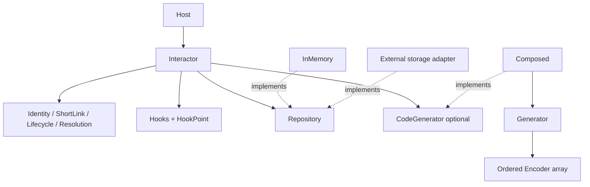

# Ports and adapters · v0.2

Core requests behavior through two duck-typed contracts. It never imports a concrete adapter. The host explicitly constructs Repository, optional CodeGenerator and Interactor; ctx carries opaque per-call host data, not dependency discovery.

## Repository

Repository provides create/get/update/delete. Get retrieves an independent entity, leaving read-time resolvability to Resolution. Writes enforce identity uniqueness, latest-state validation, sparse fields and terminal deletion atomically. Failure cannot partially commit. Deleted/expired identities do not become reusable.

Interactor performs no update/delete pre-read. The repository validates a complete candidate, then optional can_update, then commits under the storage's atomic mechanism. can_update=false is INVALID. Delete validates both target-state validity and transition. External storage needs its own transaction/lock/CAS implementation; Core cannot make an unprotected get/modify/set atomic.

The four bundled adapters are ready-to-use general building blocks, not driver stubs. InMemory data is scoped to its object and Lua VM, with no restart durability or cross-worker sharing. The bundled InMemory adapter uses a nested namespace/code map, independent metadata snapshots and non-yielding writes within one Lua VM. It proves neither cross-process uniqueness nor concurrent database behavior. External cache decorators implement the same port and own their consistency model.

## CodeGenerator

CodeGenerator.generate(ctx,input) returns final Code. Code is the only representation Core needs; it does not need an internal ID, encoder alphabet or numeric domain. Callers supplying explicit valid Code need no generator. Missing Code invokes the optional port; invalid explicit Code is rejected directly.

Composed is a reference adapter, not a new Core framework. It calls generator.generate(ctx), followed by an ordered dense array of encoder.encode(value). Intermediate values remain opaque. Empty encoder arrays work when the generator already returns Code. Failure stops immediately; final output must be a non-empty string.

Sequential and Base62 remain replaceable components inside that adapter. Their exact integer domain [0,2^53-1] and Sequential's instance-local uniqueness/exhaustion do not constrain generic CodeGenerator. Full uint64 or string identifiers need compatible external components without lossy tonumber coercion. Sequential counters are independent per instance and reset when reconstructed; Repository is still the uniqueness authority.

The two ports also support a host CodeGenerator deriving Code from a URL, and a Repository decorator with two read fronts plus one authoritative tier. These are composition choices, not new Core modes. The executable cases in spec/composition_spec.lua cover cold/warm reads, write invalidation, tombstones and failures using in-process storage only; they do not establish external cache consistency or database concurrency.

## Keep integrations outside Core

| Host or adapter concern | Why it stays outside Core |
| --- | --- |
| HTTP/OpenResty | Transport does not define identity or resolution |
| Redis/Postgres connections | Storage-specific resource and atomicity mechanisms |
| Cache invalidation | Adapter-specific consistency and failure model |
| Authorization/tenant policy | Namespace and ctx are not access control |
| Telemetry delivery | Hook observation does not supply queues or durability |
| CAS/version fields | Optional adapter/host condition, not a universal domain value |

The [API](../api.md) specifies method responses; the [operations guide](../how-to.md) explains integration; [conformance](../rfc/conformance-tests.md) defines the evidence an adapter must supply.
