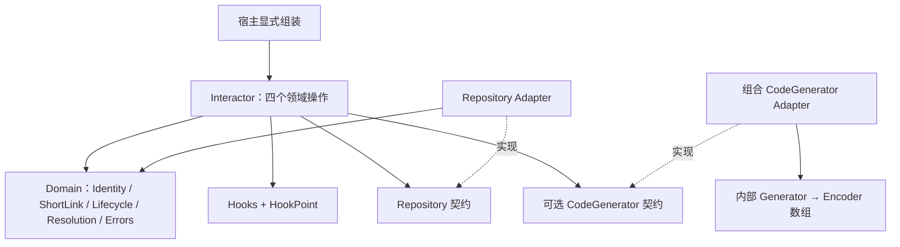

# lua-slds v0.2 架构与公共 API 提案

状态：**已收敛并实施，交付验证中**。日期：2026-10-18。基准提交：4465fa7。

依据：[issue #6](https://github.com/fangfengxiang/lua-slds/issues/6)、用户提供的《公共 API 与模块架构整理》及后续《架构重构方案》。后续补充优先；用户恢复最初的实施、测试和 GitHub CI 要求后，按第 12 节收敛差异。

本设计记录 v0.2 的定位、取舍与实现契约。初始实现已通过 PR #7 合并至 main（2d0e47d）；后续 Hooks 定案以 [收尾计划](v0.2-cleanup.md) 为准。验证结果见 [验证记录](../validation.md)。

## 1. 从项目定位判断改动价值

SLDS 的核心仍是 **Identity + Lifecycle + Resolution Semantics**。建议继续称为纯 Lua 短链领域规范及参考类库；Interactor 是四个用例的编排对象，不把项目定位扩大为通用“用例执行框架”。

本轮最有价值的改变有三项：Core 只索取最终 Code；写入规则收敛到权威 Repository 的原子提交边界；Resolution 明确给出 resolvable。它们分别减少算法绑定、陈旧预读和调用方重复判断。

Service 改名 Interactor、HookPoint 和根导出整理属于接口一致性改进，不应独立成为继续拆模块的理由。保留现有实体快照、身份元组、纯 Lua 实现和测试设施。

遵守 RFC-0001 的十条铁律，尤其是 RULE-001/002/003 的基础设施隔离、RULE-004/005/006 的身份与持久化约束、RULE-007/008 的观察者边界、RULE-009 的宿主鉴权及 RULE-010 的符合性证据。

## 2. 推荐范围与明确排除

推荐一次有版本边界的 v0.2 契约升级：Interactor、两个 Core Port、可注入 Lifecycle、CodeGenerator 组合适配器、明确的解析结果、按运行点分组的同步 Hooks。

本轮不实现 Redis/Postgres/CachedRepository、Snowflake/UUID/64 位编码器、缓存一致性协议、Outbox、消息队列、DI Container、全局 Registry、规则引擎或通用 Pipeline 框架。不增加批量 API、get 用例、quickGet、版本字段或 metadata 深合并。

三个方案的取舍：

| 方案 | 收益 | 代价 | 建议 |
| --- | --- | --- | --- |
| 仅修 v0.1，不改入口与 Port | 迁移小 | 无法支持无需双生成器的创建方式，接口歧义保留 | 不满足此次目标 |
| 收敛 v0.2 契约，复用现有模块和工具 | 解除绑定，写入与解析职责清楚 | 有明确破坏性变更 | **推荐** |
| 同时建设缓存、策略与通用执行框架 | 更多基础设施能力 | 偏离领域定位，测试与依赖面显著扩大 | 不纳入 |

## 3. v0.1 基线逐文件盘点

改造前 15 个生产 Lua 文件均有 LuaCov 100% 行覆盖率；此结果是 v0.1 基线，不是 v0.2 已实现的证据。下表的测试文件省略 spec/ 前缀。

| 当前文件 | 实际职责与依赖 | 现有测试 | v0.2 建议 |
| --- | --- | --- | --- |
| src/slds/init.lua | 导出 Domain/Hooks、new 和扁平常量；加载 Service | public_api_spec、service_spec | new 转向 Interactor；新增 Interactor/HookPoint；收敛常量出口 |
| src/slds/service.lua | 编排四操作；依赖 Domain/Hooks；强制 generator+encoder；更新删除有预读 | service_spec、service_boundaries_spec、L0–L3 | 迁为 interactor.lua；更新删除只调用一次 Repository 写方法 |
| src/slds/hooks.lua | 插件对象列表、运行点字符串拼接、pcall、独立领域快照 | hooks_spec、hook_observation_spec、L3 | 改为按 HookPoint 索引的有序函数数组，保留隔离保障 |
| src/slds/internal/snapshot.lua | 复制原始 table 图，保留环与共享子表，去掉元表 | value_boundaries_spec、Hook/metadata 测试 | 保留；不变成通用冻结工具 |
| src/slds/domain/identity.lua | 元组构造、默认 namespace、值相等、字符串表示；不依赖 Port | identity_spec、入口与 Hook 测试 | 保留普通 table 的逻辑不可变约定 |
| src/slds/domain/lifecycle.lua | 固定三状态和转换矩阵；validate_transition 抛异常 | lifecycle_spec、L1 | 增加 is_valid，接受覆盖规则，移除 validate_transition |
| src/slds/domain/short_link.lua | 字段校验、稀疏补丁、metadata 快照；当前还判断可解析性 | short_link_spec、value_boundaries_spec | 接收 Lifecycle；移除 is_resolvable；未知补丁拒绝 |
| src/slds/domain/resolution.lua | 纯解析结果与决策，依赖 Lifecycle/Errors；当前无 resolvable | resolution_spec、L0/L1 | 增加 resolvable；等值过期；使用注入规则 |
| src/slds/domain/errors.lua | 当前混合操作错误与解析状态 | public_api_spec、领域/合规测试 | 仅保留 NOT_FOUND/CONFLICT/INVALID |
| src/slds/ports/repository.lua | 四方法契约桩；不提供具体实现 | public_api_spec、L0–L3 | 保留方法；明确最新状态校验与失败契约 |
| src/slds/ports/generator.lua | 内部 ID 生成端口桩 | public_api_spec | 从 Core 移除；算法组件约定移至适配器文档 |
| src/slds/ports/encoder.lua | ID 到 Code 的端口桩 | public_api_spec | 从 Core 移除；保留适配器内部编码组件 |
| adapters/inmemory/repository.lua | 二层元组映射、独立快照、无 yield 原子操作；删除直接改状态 | reference_adapters_spec、真实 fixture 合规测试 | 注入规则与 can_update；删除也校验转换 |
| adapters/sequential/generator.lua | 实例内递增整数、范围与耗尽行为 | reference_adapters_spec、fixture_spec | 保留，作为组合生成器的内部组件 |
| adapters/base62/encoder.lua | 安全整数范围的确定性 Base62 | encoder_spec、reference_adapters_spec | 保留，不隐式支持完整 uint64 |

基线实际 require 关系是 Service 依赖 Domain、Hooks、snapshot；Hooks 也依赖 Identity/ShortLink/Resolution 和 snapshot；具体 Adapter 可依赖 Domain。基线尚无 Interactor。Port 是鸭子类型契约，不必让 Domain require Port 桩。第 4 节是目标逻辑契约图，不能将其误写成当前源码已有的 require 链。

改造前测试入口共 17 个：13 个顶层 *_spec.lua、4 个合规入口；另有 helpers.lua 与 4 个可复用合规模块。总计 209 项测试。迁移时保留边界测试含义，不为重排目录机械搬迁所有测试。

新增生产模块为 interactor.lua、hook_point.lua、ports/code_generator.lua、adapters/composed/code_generator.lua；同时移除旧 Service 和两个旧 Core Port，共享归一化采用内部函数模块后，实际从 15 个变为 17 个生产模块，没有引入管理器。

## 4. 目标架构与公共入口



根模块建议公开 VERSION、new、Interactor、Identity、ShortLink、Lifecycle、Resolution、Errors、Hooks、HookPoint。不导出 Port 桩或参考 Adapter；移除现有扁平状态/错误别名。不增加 Operations/Statuses 重复命名空间，见评审项 R2。

```lua
local slds = require('slds')
local interactor = slds.new({
    repository = repository,          -- 必需；由宿主构造
    code_generator = code_generator,  -- 可选；Core 不自动装配
    lifecycle = lifecycle,            -- 可选；允许局部覆盖
    clock = clock,                    -- 默认 os.time
    hooks = hooks,                    -- 默认空注册表
})

local link, err = interactor:create(ctx, input)
local result, err = interactor:resolve(ctx, identity)
local updated, err = interactor:update(ctx, identity, patch)
local ok, err = interactor:delete(ctx, identity)
```

不从 ctx 定位依赖；ctx 原样传递，Core 不解释宿主资源或业务键。new 与 Interactor.new 使用同一个构造实现。

## 5. 领域规则与实体

Lifecycle 只保留 ACTIVE/DISABLED/DELETED 三种持久状态，以及 is_valid(status)、can_transition(from,to)、is_resolvable(status) 三个纯谓词。默认转换矩阵延续 v0.1；同状态补丁不调用转换谓词。业务非法转换返回 nil,Errors.INVALID。

允许部分覆盖，缺项采用默认函数；不能修改用户传入的表。Interactor 与权威 Repository 必须使用同一套有效函数，运行期不重新合并或修改配置。归一化只发生在组装期，不能在解析热路径持续分配规则表。

共享归一化采用 internal/lifecycle.lua 小型函数模块，供 Interactor 与 Repository 构造时复用。公共 Lifecycle 仍只提供三个谓词，不暴露内部归一化函数。直接领域调用按需读取覆盖函数，不在热路径合并规则表。

硬不变量不能被自定义函数放宽：身份不可改名、未知持久状态不合法、DELETED 不可恢复/解析、删除身份不可复用。is_valid 只能进一步限制三个合法状态；can_transition/is_resolvable 即使错误地返回 true，也不能绕过终态。

ShortLink.new(data,lifecycle)、link:with_patch(patch,lifecycle)、is_expired(now)、to_table() 保留。移除 link:is_resolvable(now)，解析只走 Resolution。新建记录的状态由 Interactor 固定为 ACTIVE；建议拒绝 create 输入中的显式 status，避免看似生效但被忽略。

补丁建议只允许 target/status/expires_at。namespace/code 属于编程错误；metadata 和其他未知字段返回 INVALID，不静默忽略。metadata 仍创建时持久化、后续保留，不增加更新或合并语义。

根据最新补充，nil expires_at 表示未提供，false 也不是清除哨兵；暂不提供清除功能。这与 issue 的清除语义目标尚未一致，见 R1，不能声称已完成该项。

metadata 继续复制原始 table 图；不执行/运输元表，非 table 叶子按原值保留。真实持久化格式可支持更窄的数据集，Adapter 必须验证并说明；Core 支持循环 table 快照，不代表 JSON/数据库支持相同数据。

## 6. Resolution 与错误

Resolution.resolve(link,identity,now,lifecycle) 只做纯领域判断，返回独立结果：found、resolvable、namespace、code、target、status、expires_at。

| 判定顺序 | found | resolvable | status | target |
| --- | --- | --- | --- | --- |
| 无记录 | false | false | NOT_FOUND | nil |
| DELETED | true | false | DELETED | nil |
| 注入规则不允许解析 | true | false | 实际持久状态 | nil |
| expires_at <= now | true | false | EXPIRED | nil |
| 可以解析 | true | true | 实际持久状态 | 原目标 |

只有 resolvable 是宿主判断能否跳转的标准字段。若自定义规则允许 DISABLED 解析，结果须保留 DISABLED，不能改写成 ACTIVE；DELETED 和过期仍有硬保护。过期不写回 Repository。now 与 expires_at 仍要求有限数值。

Errors 仅包含 NOT_FOUND、CONFLICT、INVALID。EXPIRED 归于 Resolution.EXPIRED；DISABLED/DELETED 使用 Lifecycle 常量。

| 情形 | 返回 |
| --- | --- |
| 业务成功 | result,nil |
| 创建身份重复、Adapter 条件提交冲突 | nil,Errors.CONFLICT |
| 非法字段/转换、can_update 拒绝、终态更新或重复删除 | nil,Errors.INVALID |
| update/delete 不存在 | nil,Errors.NOT_FOUND |
| resolve 不存在 | 正常 NOT_FOUND ResolutionResult，err=nil |
| 基础设施故障 | nil,原始 err |
| 编程错误或依赖违约 | error(msg,2)，不伪装成业务失败 |

Repository/CodeGenerator 返回 nil,nil 属于依赖违约；不再当作不存在。稳定错误码不拼接前缀。建议同样识别 result 与 err 同时非 nil 的违约。Core 不用 xpcall 包住整个用例，编程异常不保证 AFTER。

## 7. Repository 与条件提交

只保留 create/get/update/delete。Interactor 的 update/delete 捕获参数后直接调用一次写方法，不先 get，也不先执行 with_patch。权威 Adapter 在自己的原子提交范围内完成最新读取、规则检查、提交和结果快照。

更新流程：定位最新记录 → 不存在 NOT_FOUND → DELETED INVALID → with_patch 完整校验字段/键/转换并生成候选实体 → can_update → 提交。策略只接收字段值已经验证的原始稀疏补丁，不能把候选实体的全量字段当作补丁。这样普通数值比较策略不会因为收到字符串 expires_at 而把 INVALID 变成异常；非法补丁不调用 can_update。

can_update(current,patch) 只注入权威 Repository，不注入 Interactor 或实体。它是纯、同步、不 yield 的布尔谓词：false 返回 INVALID，非布尔返回或异常是编程错误，事务必须回滚。传给谓词的观察值不得被其修改后带入实际提交。

删除也必须在最新状态上复用实体变换，例如 with_patch({status=DELETED},rules)，同时校验目标状态有效性及 can_transition(current,DELETED)。任何拒绝返回 INVALID；重复删除返回 INVALID。不能只检查转换而绕过自定义 is_valid，写出随后无法重建的记录。成功后保留身份占用。can_update 不负责删除，避免产生第二套删除策略入口。

不同字段的稀疏更新保留彼此结果；同字段按提交顺序生效。这不等于自动识别应用层陈旧读改写。v0.2 不增加通用 revision/if_match 字段；外部 Adapter 可使用宿主约定的 opaque ctx 条件执行 CAS，失败返回 CONFLICT。该能力必须单独给出并发证据，不能用 can_update 的一般业务拒绝冒充 CAS。

缓存装饰器保持同一 Port，Core 不认识 L1/L2 或失效方法。推荐缓存实体快照，每次 resolve 重新按时钟计算；状态陈旧、负缓存、回源重填、提交成功但失效失败由 Adapter 声明一致性模型。缓存测试只约束声明该能力的外部实现，不作为无缓存 Repository 的最低门槛。本轮不新增缓存示例实现或 Redis 集成平台。

## 8. CodeGenerator 与组合适配器

CodeGenerator:generate(ctx,input) 直接返回最终 Code。仅 code==nil 才调用它；显式空串、错误类型返回 INVALID，不能悄悄自动生成。未提供 Code 且未注入生成器返回 INVALID。显式有效 Code 可在没有生成器时创建。

生成器收到独立输入快照；它的修改不得影响实体、调用者或 Hook。最终结果必须是非空字符串；不能自动 tostring/tonumber。冲突交由 Repository，Core 不重试，也不把确定性 Hash 当作幂等创建协议。

组合参考 Adapter 接收 generator 与 encoders 有序数组。构造时校验并捕获数组顺序；拒绝洞和非编码器条目。执行时先 generator:generate(ctx)，再逐项 encoder:encode(value)；首个失败立即停止，原样返回错误。空数组合法，要求 Generator 自己返回 Code。

中间表示由相邻组件约定，Core 不建立 ID 类型联合或数值范围。Sequential/Base62 的 [0,2^53-1] 与耗尽行为保持适配器专属；完整 uint64 不能通过 tonumber 暗中进入当前 Base62。64 位字符串编码器留给有真实需求的外部实现。

## 9. Hooks 与完整用例边界

采用 HookPoint 的 BEFORE/AFTER、八个操作专属点及 ON_ERROR。内部 handlers[point] 是有序函数数组，没有 next()、Middleware、异步调度器或插件发现。

固定阶段顺序：通用 BEFORE → 专属 BEFORE → 操作 → 专属 AFTER → 通用 AFTER。同一运行点内按注册顺序；不能宣称不同运行点之间也按全局注册时间排序。

BEFORE 放在容器/身份等调用契约检查及输入捕获后、生成器/实体业务校验/Repository 之前，覆盖整个有效用例。每个正常返回路径恰好触发一次专属 AFTER 和一次通用 AFTER，包括 INVALID、CONFLICT 与基础设施错误。

| 注册点 | 回调签名 |
| --- | --- |
| BEFORE_CREATE | fn(ctx,point,input) |
| BEFORE_RESOLVE / BEFORE_DELETE | fn(ctx,point,identity) |
| BEFORE_UPDATE | fn(ctx,point,identity,patch) |
| AFTER_CREATE / AFTER_UPDATE | fn(ctx,point,link,err) |
| AFTER_RESOLVE | fn(ctx,point,result,err) |
| AFTER_DELETE | fn(ctx,point,ok,err) |
| ON_ERROR | fn(ctx,failed_point,hook_err) |

通用 BEFORE/AFTER 收到具体操作点及相同参数。ON_ERROR 是明确的异常通知特例，第二位是失败点，不再额外传 ON_ERROR 常量。ON_ERROR 自身失败不递归。

每个回调执行前分别复制领域参数，保留 Identity/ShortLink/Resolution 的公开行为与 nil 参数位置；ctx 不复制且按只读约定使用。返回值忽略，异常逐个 pcall 隔离。未注册该点时直接返回，不构造快照。

AFTER_DELETE 的结果仍是 bool，不额外新增实体查询或返回值结构。Hook 是同步观察者，延迟计入操作，不承诺超时、沙箱、可靠投递或事务事件。

初始 PR #7 曾保留 use(hook) 便利入口；最新收尾定案移除该方法，仅通过 Hooks:on(point,fn) 在启动期按点注册。Interactor 只分发，回调统一使用 v0.2 签名；不增加批量、优先级或插件生命周期 API。

## 10. Lua 实现与性能约束

- 继续共享类元表、静态点号工厂、实例冒号方法，保持 Lua 5.1/5.3/LuaJIT 语法；Core 零新增运行时依赖。
- 构造期校验 Port 方法、规则函数、编码数组和运行点，捕获配置；热路径不发现模块、不重复合并规则、不创建通用执行上下文。
- Hooks 按点直接查数组，数字循环执行；无回调时不复制 payload。保留必要的输入、存储和观察者快照，不为节省分配取消隔离。
- update/delete 去掉一次 Repository 预读是明确的 I/O 收益；不在本轮给出未经测量的吞吐或延迟倍数。
- 不为行数拆分 Interactor，也不为 Pipeline 新建框架。新增内部辅助文件须有共享逻辑和可测契约的实际依据。

## 11. 迁移与验证计划

| 阶段 | 交付物 | 独立验收 |
| --- | --- | --- |
| A 契约冻结 | 评审本提案及 R1–R5，形成 RFC-0002 | 与 issue 的差异逐项决定 |
| B Domain | Errors/Lifecycle/ShortLink/Resolution | 纯规则、等值过期、自定义规则硬约束、独立快照 |
| C Repository | 原子校验、can_update、删除规则 | 直接 Adapter 调用、拒绝无写入、可控交错 |
| D 生成组合 | CodeGenerator Port 与组合 Adapter | 显式 Code、零/多编码器、失败短路、精度边界 |
| E Hooks 与 Interactor | 新入口与分发 | 四操作、无更新删除预读、正常失败 AFTER、nil 缺口 |
| F 公共导出与打包 | init、rockspec、.versions、迁移说明 | 安装后独立目录 CRUD；版本来源 check/sync 可用 |
| G 文档与 CI | RFC/API/双语 README/示例/合规指南/AGENTS 对齐 | 三解释器、逐文件95%、严格文档构建 |

新测试先失败再实现。保留现有成功、拒绝、快照、元组 NUL、终态和错误传播断言；仅因契约明确改变而迁移预期，不删除难测分支以满足覆盖率。

必须新增：部分规则覆盖及不改输入表；DISABLED 自定义可解析；DELETED 硬保护；相等时间过期；未知补丁和非法清除值；字段无效时不调用策略；can_update 拒绝/异常原子性；删除转换或目标状态有效性拒绝；空 Code 不生成；生成器输入隔离与 nil,nil；Pipeline 顺序/数组洞/中断；Hook 阶段顺序、正常失败 AFTER、ON_ERROR 非递归；入口捕获身份与补丁；update/delete 不 get。

测试范围继续是全部 src/ 与 adapters/ Lua 文件，每文件至少95%，包含未加载文件。Lua 5.1、Lua 5.3、LuaJIT 分别测量；Lua5.5可作额外本地检查。Codecov project/patch 至少95%、零容差。顺序测试、可控交错与真实数据库并发分别报告；外部缓存/CAS 未运行就标为未验证。

文档实施时新增 RFC-0002 与迁移说明；RFC-0001 保留为 v0.1 历史规范并标明版本。README 最短示例只使用内置 Adapter，不能以未提供的 Postgres/CachedRepository 作为开箱示例。AGENTS 中原有三个 Port、严格小于过期，以及旧文档中的 metadata 补丁忽略行为已经同步为 v0.2。

.versions 当前只匹配 init.lua 的 _M.VERSION 独立赋值及 API 文档版本行。若照附件把版本改写成表内 VERSION 字段，必须同步清单正则；否则发布脚本会失去版本来源。验收包含仓库外路径的版本 check/sync 及同步幂等，不只检查版本字符串表面正确。

验收完成后按 issue 要求，在独立 codex/ 分支提交 Draft PR；附迁移说明和实际 CI/Codecov 证据，不直接合并 main。交付检查在独立分支执行这些操作。

## 12. 已收敛的差异

| 编号 | 差异 | 本轮决定 |
| --- | --- | --- |
| R1 | issue 要求清除 expires_at，最新补充暂不提供哨兵 | 遵循最新补充：不新增清除功能；明确延期，不声称完成该项 |
| R2 | issue 使用 core.lua、Operations/Statuses | 遵循附文：Interactor、Lifecycle/HookPoint，移除根扁平别名 |
| R3 | issue 保留 use(hook)，补充使用 on(point,fn) | 初始 PR #7 保留便利入口；后续定案移除，统一使用 Hooks:on |
| R4 | 条件更新拒绝与并发冲突 | can_update=false 返回 INVALID；外部 CAS 冲突返回 CONFLICT，不新增 Core 版本字段 |
| R5 | 三个公共 Lifecycle 谓词与共享归一化 | 新增内部函数模块 internal/lifecycle.lua，不增加公共管理器 |

未知 Patch（包括 metadata）返回 INVALID，根扁平常量移除，BEFORE 覆盖完整有效用例，create 显式 status 拒绝，均已纳入实现和回归测试。

## 13. 实施与验证证据

v0.1 基线：209 项测试，15 个生产文件行覆盖率 100%。v0.2 初次全套验证：Lua 5.1、5.3、LuaJIT、Lua 5.5 各 253 项测试通过，17 个生产文件逐文件 100%；后续新增验证以 [验证记录](../validation.md) 为准。

Domain/Repository、Hooks、CodeGenerator、Interactor 均先记录失败测试再实现。独立审查检查全部生产模块，发现并修复 Repository Port 的旧错误码注释；没有据此声称验证外部数据库并发、CAS 或缓存集成。

OpenSpec 保存在被 Git 忽略的 openspec/ 中；当前设计和实施计划进入版本控制，不能将本地 OpenSpec 声称为远端已跟踪文件。保留用户原始 docs/report.md，按 issue 要求通过独立分支与 Draft PR 整体评审。
